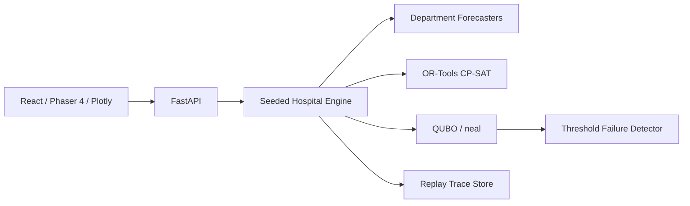

# B.Tech Project Report Material

> Source material only. The team must write the report in its own words, verify every number against `results/`, and supply all team-specific details.

[TEAM TO FILL: project team names, roll/SRN/PRN numbers, guide, department, academic year, submission date]

## 1. Front Matter

**Keywords:** healthcare operations, demand forecasting, XGBoost, hospital simulation, nurse allocation, CP-SAT, QUBO, quantum annealing, QAOA.

**Draft abstract (≤300 words):** This project presents an end-to-end hospital operations intelligence platform that simulates seeded hourly admissions across General Medicine, Cardiology, Orthopedics and Neurology. It combines a per-department forecasting module, a classical OR-Tools staffing baseline, a compact QUBO solved by quantum-inspired annealing, and a disruption-aware hybrid policy. A browser interface provides an isometric management view, live decision feed, disruption controls and matched analytics. The backend is implemented in Python/FastAPI and exposes simulation, metrics, WebSocket, replay trace and measured-failure endpoints. Identical thresholds detect demand misses, overcapacity, staffing breaches, forecast misses and slow recovery; results are computed from simulated step traces rather than hand-labelled failures. The current evidence is synthetic and exploratory. It does not establish clinical validity or quantum advantage.

## 2. Chapter Map

1. **Introduction** — motivation, problem statement, objectives, scope and assumptions.
2. **Literature Review** — hospital forecasting, bed/nurse allocation, QUBO/QAOA/annealing and simulation. References marked `[VERIFY]` must be sourced before submission.
3. **System Design** — architecture, data flow, modules, equations and parameter table.
4. **Implementation** — exact versions, models, optimization, API and game engine.
5. **Results and Discussion** — actual CSV and experiment analysis, failure evidence, mean ± std and limitations.
6. **Conclusion and Future Work**.

## 3. System Architecture



The exact repository modules are documented in `docs/ARCHITECTURE.md`. The reported experiments come only from `scripts/run_experiments.py` and `results/mode_comparison.csv`.

## 4. Equations

Arrival seasonality and the state model are defined in `docs/REPORT_MATERIAL.md` source equations:

$$\lambda_{d,h}=b_d[1+s\sin((h-7)\pi/12)+w_d]+e_d$$

$$B_{d,t+1}=B_{d,t}-D_{d,t}+A_{d,t}$$

$$n_{d,k}=x_{d,k}\in\{0,1\},\qquad \sum_k x_{d,k}=1$$

$$E(x)=\sum_d\sum_k(k-t_d)^2x_{d,k}+A\sum_d(\sum_kx_{d,k}-1)^2+B P(\sum_d kx_{d,k}\le N)$$

## 5. Figure and Table Registry

- Figure 3.1 — System architecture. Export from Mermaid or `docs/report_figures/`.
- Figure 3.2 — Dimetric isometric hospital.
- Table 4.1 — Technology stack exact versions.
- Figure 5.1 — Matched mode unmet-demand comparison.
- Table 5.1 — Mean ± std across seeds and disruption scenarios.

## 6. Reproducibility

Commands:

```powershell
python scripts/generate_synthetic_data.py
python scripts/train_models.py
python scripts/run_experiments.py
python scripts/export_report_figures.py
pytest -q backend/tests
npm --prefix frontend test
npm --prefix frontend run build
```

The team must record the local hardware, OS, Python/Node versions, commit hash and exact run date in the final report.

## 7. Appendix

Include API examples, threshold YAML, a worked QUBO, sample trace JSON and Docker commands. The source should be verified against the live Swagger UI at `/docs`.

**End note:** apply the department Word formatting rules, 12 pt Times New Roman, 1.5 line spacing, standard margins and the page budget of at most 100 pages including references and appendices.
